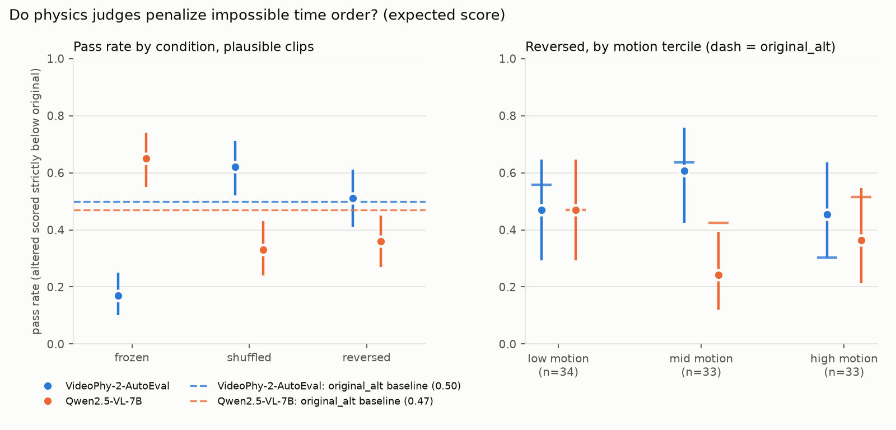

# Do physics judges notice impossible time order?

**No.** I tested two VLM physics judges on VideoPhy-2 clips that humans rated
plausible. Neither scored a clip lower when it was played backward than when its frames
were merely resampled. This held on 100 clips, through five robustness checks, and in a
pre-registered replication on 100 irreversible-action clips. VideoPhy-2-AutoEval, the
judge used as an RL reward, catches shuffled frames in its native setup, so it notices
jerky cuts, not physics. It also scores a frozen single frame *higher* than the real clip.

*Pass rate is the share of plausible clips where the altered version scored strictly
below the original (expected score `Σ s·p(s)`). Dashed lines are each judge's
`original_alt` noise floor: the same clip, frames offset by half a stride. Whiskers are
95% paired bootstrap CIs. The [integer-score version](results/passrates.png) is 92–97%
ties.*

## 1. Question

Physics judges are now used as the **reward** for training video generators pitched as
world simulators. HiPhy, for example, trains against the VideoPhy-2 judge. If the judge
cannot tell a possible time order from an impossible one, a generator optimized against
it is never pushed toward correct dynamics.

**Do VLM physics judges score a generated clip lower when its frames are reversed,
shuffled or frozen?**

## 2. Method

**Ground truth by construction.** Reversing or shuffling a clip that humans rated
plausible (`pc` 4–5) makes it implausible, so no new labels are needed. This adapts the
*Metric validity* starting point: the pass/fail rule comes from construction instead of
a hand-written physics check.

**Data.** VideoPhy-2 test split (HF video mirror). I sampled 100 plausible and 100
implausible (`pc` 1–2) clips, stratified across the 7 generators with seed 0
([`clips.csv`](clips.csv)).

**Conditions.** K = 16 evenly spaced frames, all built from the same decoded frames:
- `original`
- `original_alt`: the same grid offset by half a stride (noise floor)
- `reversed`
- `shuffled`: seeded, Spearman < 0.2 against true order
- `frozen`: the middle frame × 16

**Judges.**
- **VideoPhy-2-AutoEval**, run with its own code, prompt and parser.
- **Qwen2.5-VL-7B-Instruct**, given 16 images with VideoPhy-2's physics instruction.

Both decode greedily. I log the probabilities of the answer tokens 1–5, which gives an
integer score and an expected score per call.

**Pre-registered rule** (commits [`6b147d2`](https://github.com/Kushaan-N/physJudge/commit/6b147d2)
and [`2c9bb9e`](https://github.com/Kushaan-N/physJudge/commit/2c9bb9e) at 21:20 and
21:26 UTC; first scores committed at 21:58).
- A judge passes a clip if the altered version scores strictly below the original;
  ties fail.
- **Headline:** pass rate(`reversed`) − pass rate(`original_alt`), with a 95% CI from
  10,000 clip-level bootstrap resamples. It counts only if the CI excludes 0.

**Controls.** The `original_alt` noise floor, reversal vs shuffle, motion terciles, a
20-clip eyeball check, baseline Spearman correlation with human `pc`, and tie rates.

## 3. Result

**Baseline signal.** Spearman correlation with human `pc` on the 200 originals is 0.53
for AutoEval and 0.13 for Qwen (0.56 and 0.33 on the expected score). Qwen outputs a 5
on 559 of 600 calls.

**Headline** (reversed − `original_alt` pass rate):

| Judge | Integer score | Expected score |
|---|---|---|
| AutoEval | −0.02 [−0.06, 0.02] | +0.01 [−0.11, 0.13] |
| Qwen | 0.00 [−0.03, 0.03] | −0.11 [−0.22, 0.00] |

**Every CI includes 0.**

AutoEval:
- Reversal moves its expected score by −0.002 [−0.013, 0.008], about 2% of its 0.58 gap
  between plausible and implausible clips.
- Its reversed scores track the originals (r = 0.994) more closely than its resampled
  ones do (0.987).
- Freezing a clip *raises* its score on 83% of clips.

Qwen:
- Its scores drift slightly *up* under reordering.
- Freezing is the only alteration it penalizes (+0.18 [0.05, 0.31]).

**Reading against the pre-registered outcome table.** Both judges land in row 1 ("ignores
time; scores appearance"). In its native setup (R3), AutoEval moves to row 2: it detects
shuffling (+0.24 [0.12, 0.36]) but not reversal.

**Controls.**
- **Integer vs expected score:** same conclusion, so ties don't drive the null.
- **Top-motion tercile:** AutoEval +0.15 [−0.06, 0.36]; Qwen −0.15 [−0.36, 0.06].
- **Eyeball check:** I reviewed 20 reversed clips as flipbooks. 15 still look plausible
  backward. Excluding them leaves the null unchanged.

**Robustness** ([plan](ROBUSTNESS.md) committed before running):

| Check | Outcome |
|---|---|
| R1. Integrity audit | Pass |
| R2. Rerun on an A100 (main run: L40S) | **Fail:** 2 of 60 integers flip per judge. R2b, rerun on an L40S, is bit-identical, so the cause is the GPU model, not the pipeline. |
| R3. AutoEval via its native 32-frame mp4 path | Reversal null holds (+0.02 [−0.11, 0.15]); shuffling is detected |
| R4. Qwen prompt without "in order" | Reversal null holds (−0.03 [−0.14, 0.08]) |
| R5. Wilcoxon, margin rule, seeds, per-generator | Null holds |

**Replication** ([pre-registration](PREREG_IRREVERSIBLE.md)).
- **Sample:** 100 new plausible clips from 7 irreversible-action categories (pour, tear,
  break, cut, fire, fall, collide).
- **Labels:** made by the AI assistant, a recorded deviation, and committed before
  scoring. Only **8 of 100** reversed clips clearly break physics; most of these clips
  never show the irreversible event.
- **Result:** no judge penalizes reversal on any subset. On all 100 clips, AutoEval is
  −0.03 [−0.16, 0.10] and Qwen +0.01 [−0.13, 0.15]. The 8-clip subset falls below the
  pre-registered minimum of 30, so it is underpowered.
- **The side findings replicate:** frozen clips are rewarded and shuffling is detected.

Full tables for everything above are in [DETAILS.md](DETAILS.md).

**Scope and time.** These claims are about these two judges on these clips. It took
about 1 h from an empty directory to scored results. The calls are inference only (no
training): 21.5 min for the main 1,200 on one L40S, plus about 70 min of GPU time for
robustness and the replication.

## 4. What would change the conclusion; next week

**Threats.**
- **Generated clips rarely contain an irreversible event.** Only 3 of 20 main-study
  clips and 8 of 100 replication clips are clearly impossible backward, so reversal on
  generated video is a weak test. On the clear violations the CIs are about ±0.4, wide
  enough to hide a judge that penalizes only blatant reversals.
- **The replication labels are AI-made, from still frames,** where pour direction is hard
  to see. A human rating of the flipbooks would firm them up.

**Next week.**
1. Real video of irreversible actions (Something-Something v2 pouring, tearing,
   dropping), where the event actually happens. This gives a well-powered reversal test
   and separates "generated" from "judged".
2. The same paired test on rollouts from an action-conditioned world model, adding a
   wrong-action pairing as a second ground-truth negative.
3. A reward-hacking check. AutoEval rewards stillness, so does ranking by its score
   promote low-motion clips, and does a generator trained on it drift toward less motion?

## 5. What I'd want to work on with you

**Action sensitivity of action-conditioned world models.** When you change the action,
does the rollout follow it, or mostly the first frame? I'd measure this against a
seed-noise floor, the way `original_alt` works here. It is the dynamics-side twin of
this result: here the judge ignores time; there the model may ignore the action.

---

**Reproduce.**
- **Pipeline:** `src/sample_clips.py`, then `src/extract_frames.py`, then
  `src/judge_autoeval.py` and `src/judge_qwen.py` (`jobs/judge_all.sbatch`), then
  `src/analyze.py`.
- **Robustness:** `src/robust_checks.py`.
- **Replication:** `src/sample_irreversible.py` and `src/analyze_irreversible.py`.
- **Data:** per-call scores, with raw outputs, are in [`scores.jsonl`](scores.jsonl).
  Set `WS` to the scratch directory that holds the videos and weights.
- **Free GPU:** the Qwen part runs on a free Colab T4 with
  `--model Qwen/Qwen2.5-VL-3B-Instruct`.

**AI tools.** I used Claude (via Claude Code) to scope the design with me, implement and
run the pipeline, propose and run the robustness checks and the replication, label the
replication clips, and draft this write-up. I set the question and the pass/fail rule,
reviewed the main study's eyeball labels myself, and decided which follow-ups to run.
